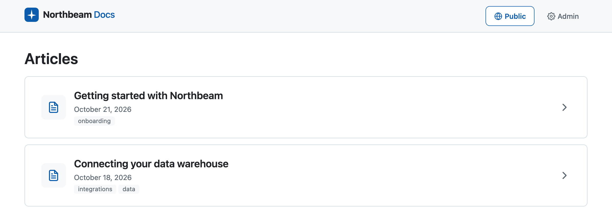

# Northbeam Docs



An internal docs studio: writers edit a single draft per article, publish it as an immutable numbered snapshot, and public readers only ever see the live snapshot.

- `backend/`: FastAPI + SQLite API (`/api/admin`, `/api/public`, `/api/health`)
- `frontend/`: Vue 3 + TypeScript + Vite writer studio and public reader

## Prerequisites

- Python 3.12+
- Node 20.19+ (with npm)

## Getting started

Installing, running, and testing the app are each a single command, run from the repository root.

**Install everything** (backend virtualenv and dependencies, the frontend's npm packages, and the headless browser the E2E checks run in):

```bash
make setup
```

**Run the app** (production mode: builds the frontend, then starts the API on port 8000 and serves the built app on http://localhost:5173; Ctrl+C stops both):

```bash
make start
```

**Run all tests** (the backend suite, then the frontend E2E checks against a mocked API; `make e2e` runs just the E2E checks):

```bash
make test
```

**Develop** (the same ports, but with the Vite dev server and hot reload, the API restarting on code changes, and the interactive API docs at http://localhost:8000/docs):

```bash
make dev
```

If your default `python3` is older than 3.12, install with `make setup PYTHON=python3.13`.

### Linting and formatting

Ruff lints and formats the backend; ESLint and Prettier do the same for the frontend.

**Check everything** (changes nothing; fails on any problem):

```bash
make lint
```

**Fix and format everything:**

```bash
make format
```

## Configuration

| Variable | Default | Meaning |
|---|---|---|
| `DOCS_DB_PATH` | `backend/data/docs.sqlite3` | SQLite file; its parent directory is created if missing |
| `DOCS_DB_BUSY_TIMEOUT_MS` | `5000` | How long a write waits for the database lock before returning 503 |
| `DOCS_ENV` | `production` | `development` serves the interactive API docs at `/docs`, `/redoc`, and `/openapi.json`; any other value, or none, turns them off. `make dev` sets `development` |

## Data model

Two SQLite tables. The single mutable draft lives on the article row; published snapshots are a separate table of immutable snapshots with controlled deletion.

| Table | Holds |
|---|---|
| `articles` | `id`, `slug` (unique, fixed after creation), `status` (`draft`, `published`, or `unpublished`), the draft (`draft_title`, `draft_body`, `draft_tags` as a JSON array), `draft_version` (incremented on every draft change, used for conflict detection), `last_published_version_number` (the snapshot counter), `current_published_version_id` (**the pointer**: the most recently published snapshot), `published_at` (first publication time), `created_at`, `updated_at` |
| `article_versions` | One immutable snapshot per publish: `id`, `article_id`, `version_number`, `title`, `body`, `tags`, `created_at` |

**Why this shape.** Drafts and published content are kept physically separate, so editing a draft can never change what readers see: the public API reads only from `article_versions`, through the pointer, and never selects a draft column. The draft sits on the article row rather than in its own table because there is exactly one draft per article, so a separate table would add a join without adding a guarantee. Snapshots get their own table because every publish must leave behind a record that can be inspected and restored but never edited; a snapshot can be removed only by an explicit delete, and never while the article points to it. With this split, each lifecycle rule maps onto a database constraint or trigger (table below), so the rules hold even against a bug in the application or a write made with direct SQL. The database has no ORM and only two tables, because the constraints are the point and the SQL is small enough to read directly.

The lifecycle rules are enforced by the database itself, not only by application code:

| Invariant | Enforced by |
|---|---|
| Snapshots are immutable, live or historical | A `BEFORE UPDATE` trigger on `article_versions` that rejects every update |
| Status, pointer, and `published_at` are consistent: a draft has neither; a published or unpublished article has both | A table `CHECK` on `articles` |
| The pointer names a snapshot of the same article | Composite foreign key `(id, current_published_version_id)` → `article_versions (article_id, id)` |
| The pointed-to snapshot cannot be deleted | `ON DELETE RESTRICT` on that foreign key |
| Snapshot numbers are unique per article | `UNIQUE (article_id, version_number)` |
| Snapshot numbers are never reused, even after deletions | The monotonic `last_published_version_number` counter, advanced inside the publish transaction (never `MAX(version_number) + 1`) |
| Slugs are unique | `UNIQUE (slug)` |
| Tags are a JSON array | `CHECK (json_valid(...) AND json_type(...) = 'array')`; the API validates the contents |

Every write runs in one `BEGIN IMMEDIATE` transaction that commits or fully rolls back. Connections use `foreign_keys = ON` and `synchronous = FULL`, and the database file is in WAL mode.

**Why unpublish keeps the pointer.** Unpublish changes only the status. The pointer and `published_at` stay, so the database keeps a record of what was last live, and the last published snapshot stays protected by the same `ON DELETE RESTRICT`. The pointer, not the highest version number, is the only source of truth for what is live: public reads join on it and filter on `status = 'published'`.

**The delete rule.** Any snapshot can be deleted except the one the article points to, which returns 409 "Snapshot is in use". Because unpublish keeps the pointer, this includes the last published snapshot of an unpublished article: it cannot be deleted while the article stays unpublished. The workaround is to publish again (unchanged content is fine), which moves the pointer to the new snapshot, and then delete the old one.

**Schema setup, not migrations.** `backend/app/migrations/` holds a single file, `0001_initial_schema.sql`. It is applied on every startup, and every statement uses `IF NOT EXISTS`, so re-running it changes nothing. There is no migration runner yet: nothing records which files have run. To change the schema of an existing local database, delete the database file and restart. The next step would be a small runner that applies numbered files in order and tracks progress in `PRAGMA user_version`.

## Errors

Every known error has one flat JSON shape; `message` is omitted when there is nothing to add:

```json
{"code": 409, "title": "Draft conflict", "message": "The draft changed since it was loaded."}
```

| Status | Title | When |
|---|---|---|
| 404 | e.g. "Article not found" | An unknown article, snapshot, or public slug |
| 409 | e.g. "Draft conflict" | A stale `expectedDraftVersion`, or a state that does not allow the action |
| 409 | "Slug already exists" | The slug is taken, including when two creates race and the database rejects the second |
| 409 | "Snapshot is in use" | The database refuses to delete the snapshot an article points to |
| 422 | (FastAPI's default `{"detail": [...]}` body, unchanged) | Invalid body, unknown field, or malformed id |
| 503 | "Database unavailable" | The database cannot be opened or initialized. Every endpoint, including `GET /api/health`, returns this, and the app recovers on the next request once the file can be opened, with no restart |
| 503 | "Service temporarily unavailable" ("The database is busy.") | A write could not get the database lock within `DOCS_DB_BUSY_TIMEOUT_MS`. No `Retry-After` header is sent and nothing retries automatically |
| 500 | "Internal server error" | Anything unexpected. The body is only `code` and `title`; the details are logged |

The two 503s differ: "Database unavailable" means the database could not be opened at all, while "Service temporarily unavailable" means it is open but a write timed out waiting for the lock.

CHECK and trigger violations return 500 on purpose: the API never attempts those writes, so reaching one means there is a bug, and a 409 would hide it. A failed write is always rolled back, and its lock released, before the error response is sent.

## A trade-off made under time pressure

**Unpublish keeps the pointer.** To make unpublish a pure status change, I kept a single pointer column, `current_published_version_id`, doing two jobs: it names the live snapshot while the article is published, and the last published one after it is unpublished. That one decision let the database enforce the lifecycle on its own: the CHECK constraint keeps status, pointer, and `published_at` consistent, and `ON DELETE RESTRICT` protects whatever the pointer names, so the last published snapshot survives an unpublish without any application code. The cost is the delete rule above: while an article is unpublished, its last published snapshot can't be deleted, and the workaround is to republish and then delete the old one. With more time, I'd split the pointer into a live snapshot (set only while published) and a separate record of the last published one, so the database would still protect what readers see, and deleting a no-longer-live snapshot would become a deliberate action instead of a dead end.

## Stretch goals

Instead of the suggested stretch goals, I built two small frontend safeguards that cut down on mistakes without extra backend plumbing:

- **Publish asks first.** A confirmation dialog/modal ("Publish this draft? Readers will see it immediately.") stops accidental publishes, so fewer publish-then-unpublish corrections, and fewer throwaway snapshots, are needed in the first place.
- **One action at a time.** While a save, publish, unpublish, restore, delete, or reload is running, every other action control and the form are disabled, and the running action shows its progress. This prevents double clicks and overlapping requests from the UI side; the backend's draft-version check (409) remains the safety net.

## What's missing and how I'd approach it

| Missing | Approach |
|---|---|
| Frontend unit tests, and E2E tests against the real backend | Vitest for the editor composables (no rendering needed), then Playwright against a real API with a temporary database |
| Slug form field, editable (the form generates the slug; the API accepts any valid slug) | An optional slug field, prefilled from the title and editable until the first save, with the 409 shown on the field |
| Slugs are random strings rather than reflecting the title; a clash is rejected with 409 and the form picks a new slug for the next save, but there's no automatic handling (like auto-suffix) | Build the slug from the title (lowercase, hyphens), and on a clash have the API add a suffix (`-2`, `-3`) and retry the insert in the same request |
| Detecting a draft with no real changes since the last publish (idempotent publish); publishing it again creates an identical snapshot | Compare the draft with the live snapshot: disable Publish in the UI when they match, and in the publish transaction return the existing snapshot instead of inserting a copy |
| Saving a snapshot without publishing ("Save as version"), as a checkpoint to restore later | Reuse publish's snapshot insert without moving the pointer or changing the status, so readers see nothing new |
| No audit log of publishing, unpublishing, restoring, or deleting, and no human approval step | An append-only events table (article, action, snapshot, time) written in the same transaction as each action; approvals need users and roles first, then a "pending review" step before publish |
| Migrations | A small runner that applies numbered SQL files in order and records progress in `PRAGMA user_version` |
| Deployment (`make start` uses `vite preview`, not a production server) | Serve `frontend/dist/` from nginx or a CDN, forward `/api` to Uvicorn, and run Uvicorn under a process manager |
